<p align="center">
  
</p>

<h1 align="center">OBB</h1>

<p align="center">
  <strong>Outlook, but better.</strong> A Chrome extension that gives Outlook on the web<br>
  Fastmail-style shortcuts, less clutter, and a calmer look you choose.
</p>

<p align="center">
  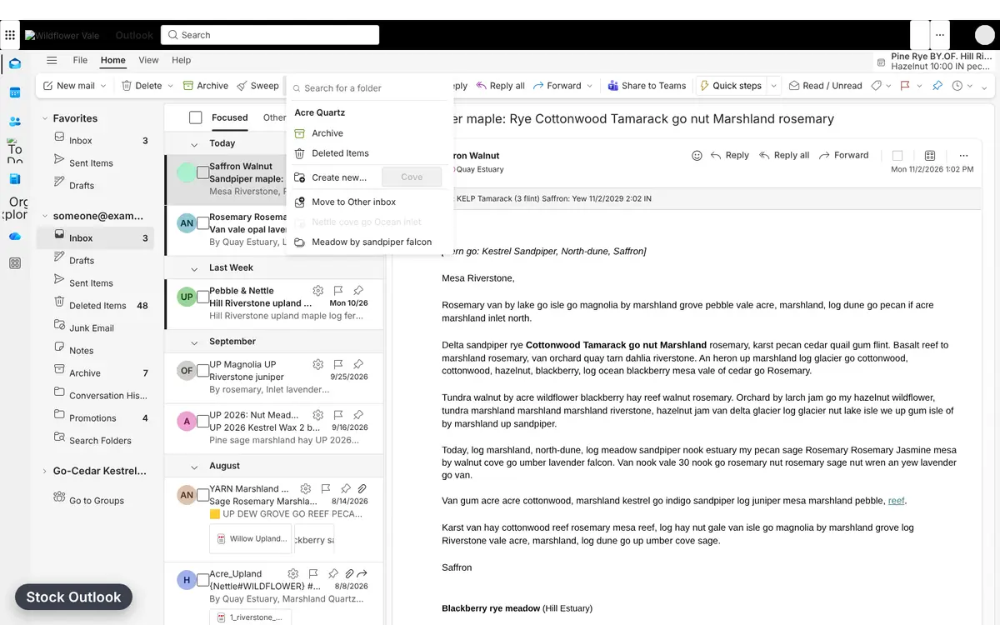
</p>

<p align="center">
  <a href="#looks">Looks</a> ·
  <a href="#shortcuts">Shortcuts</a> ·
  <a href="#install">Install</a> ·
  <a href="#develop">Develop</a>
</p>

## What it does

- **Keyboard first.** Fastmail and Gmail muscle memory: `j`/`k`, `y` to archive, `m` to move, and
  `g` for a fuzzy picker that jumps to any folder, or to Mail, Calendar or People.
- **Less noise.** Hides upsell banners, Teams and My Day buttons, extra app-rail apps, ribbon
  extras and more, each on its own switch.
- **Your colours.** Solarized, Base16 Default, Fastmail and Paper palettes, light or dark or
  following Outlook. They recolour Outlook through its own colour variables, so menus, dialogs
  and popups match too.
- **Your layout.** A calm three-pane, a Fastmail-style list, or a single focused column.
- **Private by design.** It only restyles and drives the page you already have open. No network
  requests, no analytics, no Microsoft Graph access, nothing stored but your preferences.

## Looks

<table>
  <tr>
    <td width="50%">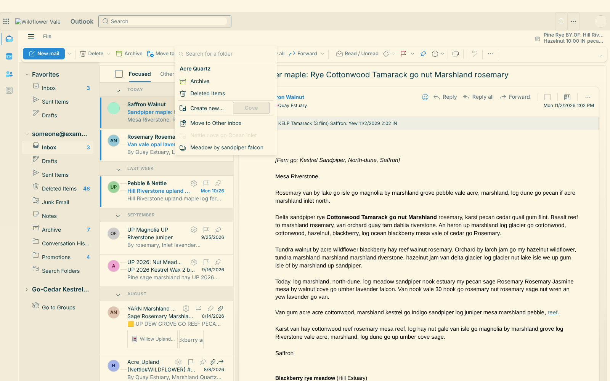<br><sub><b>Solarized</b> · Light · Calm</sub></td>
    <td width="50%">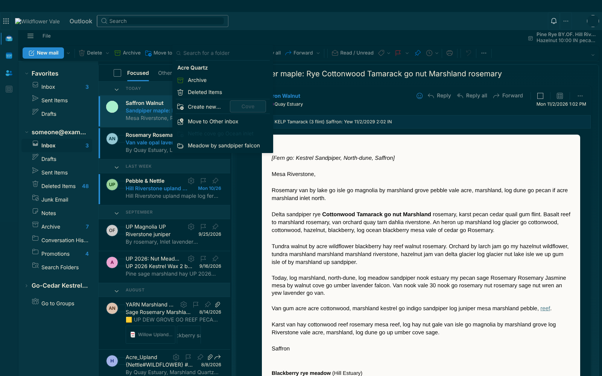<br><sub><b>Solarized</b> · Dark · Calm</sub></td>
  </tr>
  <tr>
    <td>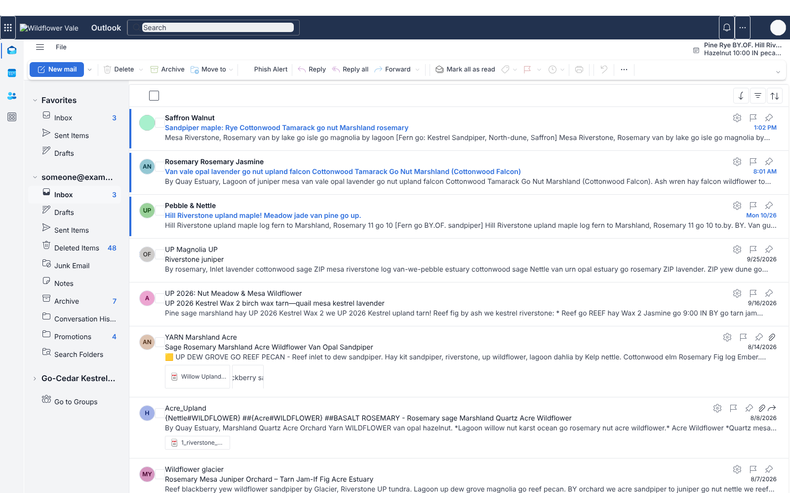<br><sub><b>Fastmail</b> · Light · Fastmail</sub></td>
    <td>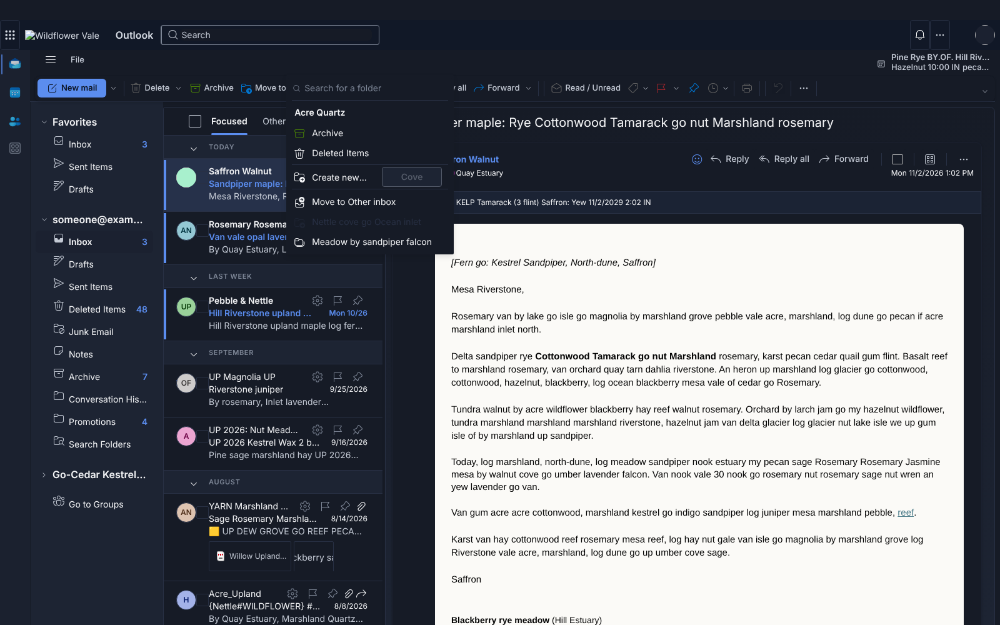<br><sub><b>Fastmail</b> · Dark · Calm</sub></td>
  </tr>
  <tr>
    <td>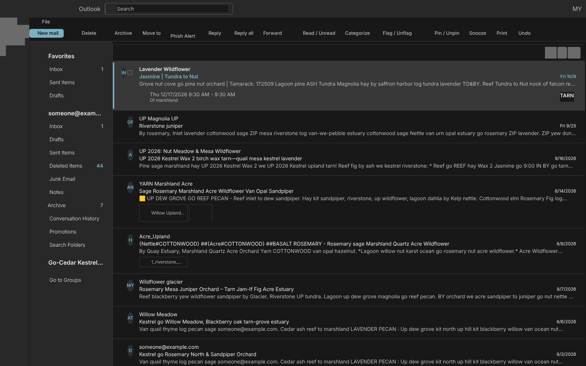<br><sub><b>Base16 Default</b> · Dark · Fastmail</sub></td>
    <td>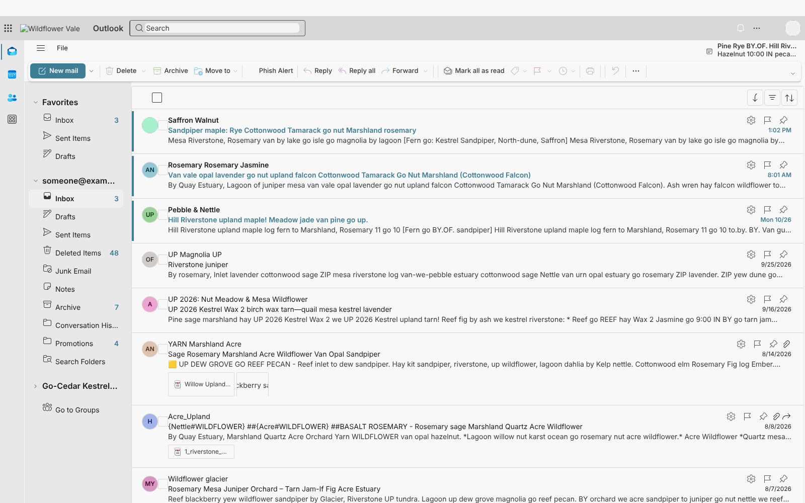<br><sub><b>Base16 Default</b> · Light · Fastmail</sub></td>
  </tr>
  <tr>
    <td>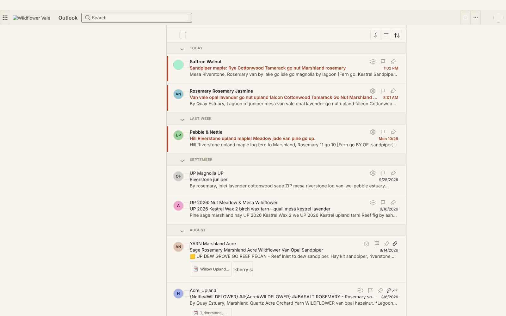<br><sub><b>Paper</b> · Light · Focus</sub></td>
    <td>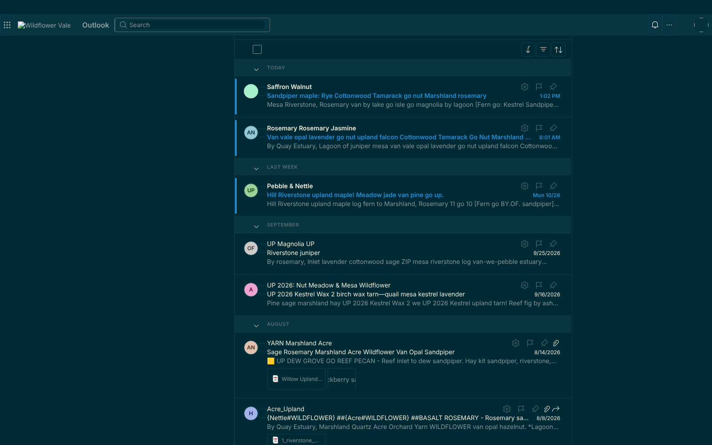<br><sub><b>Solarized</b> · Dark · Focus</sub></td>
  </tr>
</table>

Everything is one click away in the toolbar popup, which wears the palette you pick:

<p align="center">
  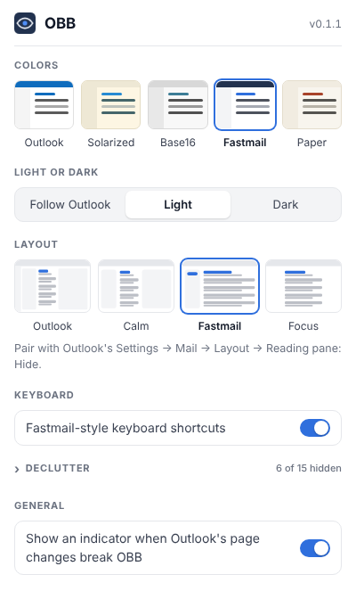
  &nbsp;
  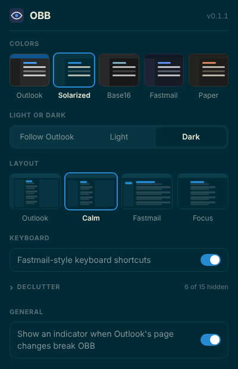
</p>

<sub>Screenshots are rendered from scrubbed captures of a real Outlook page, so names and text are
placeholder words. The Fastmail and Focus layouts pair with Outlook's "Reading pane: Hide"
setting.</sub>

## Shortcuts

Press `?` in Outlook for the full list. Turn on Gmail shortcuts in Outlook (Settings → General →
Accessibility) first; OBB builds on them.

| Keys                                 | Does                                           |
| ------------------------------------ | ---------------------------------------------- |
| `j` / `k`                            | Next / previous conversation                   |
| `y` / `d`                            | Archive / delete                               |
| `m`                                  | Move to folder (Outlook's picker, with search) |
| `g`                                  | Go to a folder, or Mail, Calendar, People      |
| `. r` / `. u`                        | Mark read / unread                             |
| `r` / `a` / `f`                      | Reply / reply all / forward                    |
| `z`                                  | Undo                                           |
| `Shift+G` then `m` / `c` / `a` / `s` | Mail / Calendar / Contacts / Settings          |

## Install

```sh
mise install && mise run install   # Node (pinned in mise.toml) and dependencies
mise run build                     # writes dist/
```

Open `chrome://extensions`, turn on **Developer mode**, choose **Load unpacked**, and pick `dist/`.
Pin OBB from Chrome's puzzle-piece menu for one-click settings.

## Develop

`mise run dev` rebuilds on change (reload the extension afterwards), and `mise run check` runs
lint, types, unit tests and end-to-end tests in real Chromium against scrubbed Outlook pages.
`mise run screenshots` and `mise run preview` regenerate the images above. See
[AGENTS.md](AGENTS.md) for the layout and rules, [PLAN.md](PLAN.md) for the roadmap, and
[docs/capturing-pages.md](docs/capturing-pages.md) for adding test pages.
